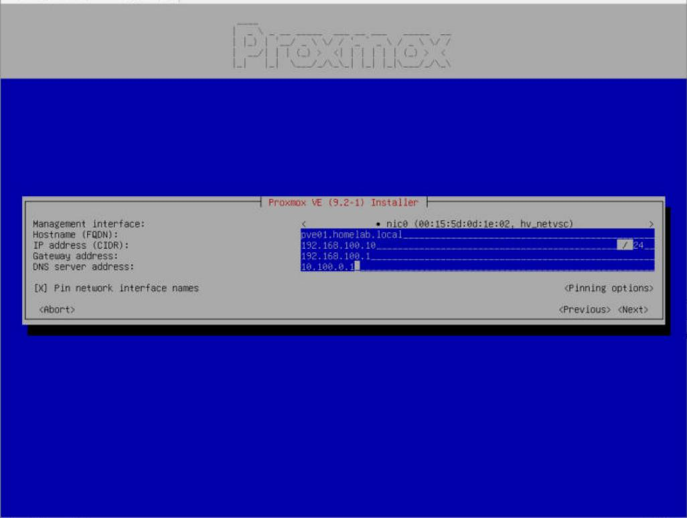
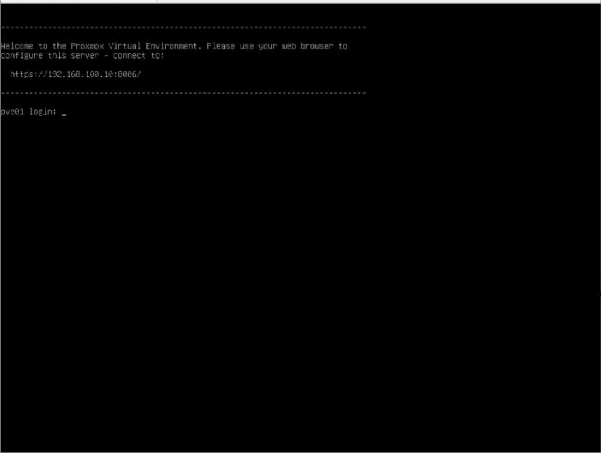
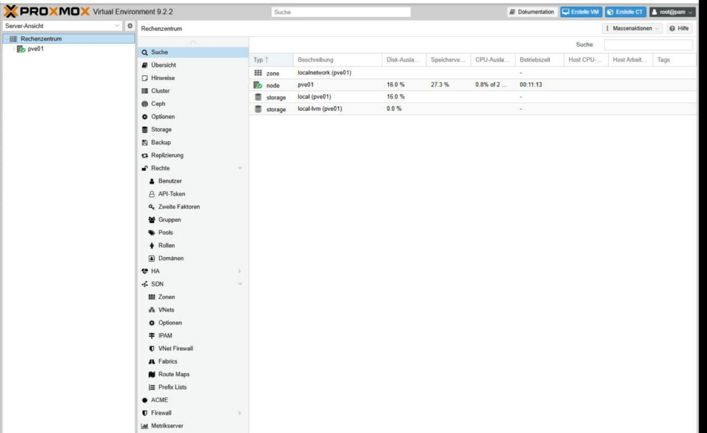

# 01 – Installation & Web-GUI

**Status:** ✅ erledigt (14.10.2026)

> 🇬🇧 **In short:** Installed Proxmox VE 9.2 as a Generation 1 Hyper-V VM with nested virtualization. Generation 2 failed because the installer could not find the ISO.

## Was und warum

Proxmox VE als VM auf Windows Server 2019 (Hyper-V) installieren. Grund: Im Lab gibt es keinen freien physischen Server. Mit Nested Virtualization kann die VM selbst Container und VMs betreiben.

## Durchgeführte Schritte

1. Proxmox VE ISO 9.2-1 geladen, SHA256-Prüfsumme kontrolliert.
2. Hyper-V-VM **PVE01** mit PowerShell erstellt: Generation 1, 2 vCPUs, 6 GB statischer RAM, 64 GB Disk.
3. Nested Virtualization und MAC-Spoofing aktiviert.
4. Installation im Terminal-UI-Modus: Hostname `pve01.homelab.local`, IP `192.168.100.10/24`, Gateway `192.168.100.1`.
5. Web-GUI geöffnet: `https://192.168.100.10:8006`

```powershell
New-VM -Name "PVE01" -Generation 1 -MemoryStartupBytes 6GB -NewVHDSizeBytes 64GB -SwitchName "Proxmox-Intern" ...
Set-VMProcessor -VMName PVE01 -ExposeVirtualizationExtensions $true
Set-VMNetworkAdapter -VMName PVE01 -MacAddressSpoofing On
```

## Troubleshooting

| Problem | Ursache | Lösung |
|---------|---------|--------|
| `no device with valid ISO found` | Generation 2: DVD am virtuellen SCSI-Controller, Installer erkennt ihn nicht | Neue VM mit **Generation 1** (IDE-Controller) |
| Grafischer Installer bricht ab | Grafikproblem in Hyper-V | **Terminal UI** gewählt |
| `SQUASHFS error` beim Neustart | ISO **vor** dem Neustart ausgeworfen, Installer lief noch vom ISO | VM über Hyper-V aus/ein – Installation war vollständig |

## Screenshots





## Was ich gelernt habe

- **Generation 1** (BIOS, IDE) läuft mit fast jedem System. **Generation 2** (UEFI, SCSI, Secure Boot) braucht Hyper-V-Treiber beim Start.
- Nested Virtualization wird pro VM aktiviert und braucht statischen RAM.
- Reihenfolge zählt: erst neu starten, dann Installationsmedium entfernen.
