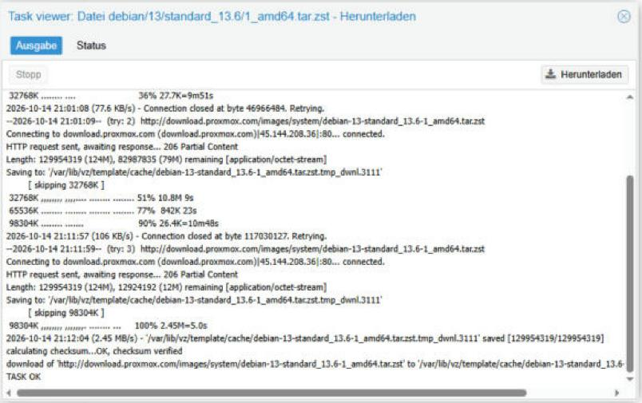

# 02 – Erster LXC-Container

**Status:** ✅ erledigt (14.10.2026)

> 🇬🇧 **In short:** Downloaded a Debian 13 template and created LXC container CT 100 with a static IP. The download stalled but resumed automatically.

## Was und warum

Einen Debian-Container erstellen. Grund: Container sind leicht und brauchen keine Hardware-Virtualisierung – ideal in einer verschachtelten Umgebung.

## Durchgeführte Schritte

1. Template **debian-13-standard 13.6-1** geladen (`local` → CT Templates).
2. CT 100 `ct-debian01` erstellt: 8 GB Disk, 1 Core, 512 MB RAM, Bridge `vmbr0`, IP `192.168.100.20/24`.
3. Container gestartet und getestet.

## Troubleshooting

| Problem | Ursache | Lösung |
|---------|---------|--------|
| Download stockt (`Connection closed ... Retrying`) | Verbindungsabbrüche im Lab | **Nicht** abbrechen. `wget` setzt fort (`206 Partial Content`). Prüfen: `ls -lh /var/lib/vz/template/cache/` |

## Screenshots

## Was ich gelernt habe

- **Container** teilt den Kernel mit dem Host, **VM** hat einen eigenen Kernel.
- Ein abgebrochener HTTP-Download kann an der gleichen Stelle weitergehen.
