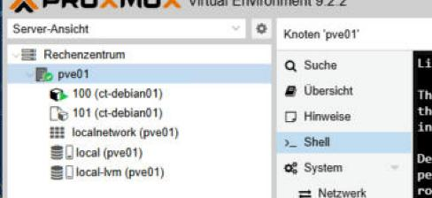
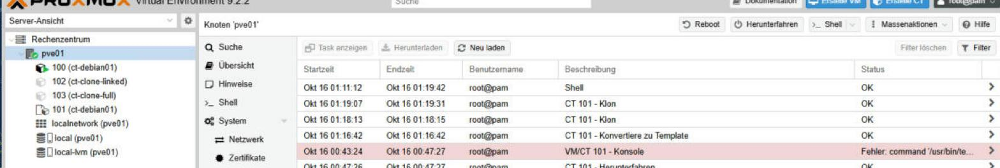
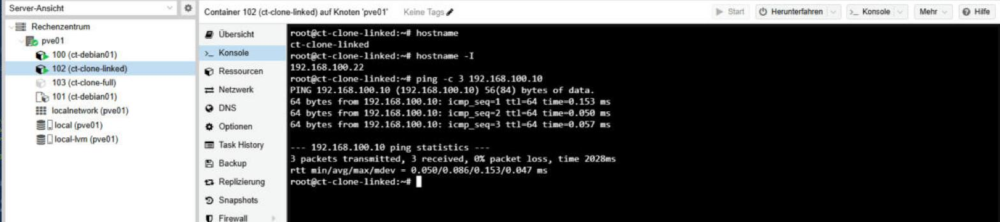

# 03 – Template & Klonen

**Status:** ✅ erledigt (16.10.2026)

> 🇬🇧 **In short:** Converted CT 101 (a restored copy of CT 100) into a template and created a linked clone (CT 102) and a full clone (CT 103). Both clones got new IPs and passed a network test.

## Was und warum

Aus einem fertigen Container eine **Vorlage (Template)** machen und daraus neue Container **klonen**. So kann man viele gleiche Systeme schnell bereitstellen.

Als Template habe ich **CT 101** genommen, nicht CT 100. Grund: Ein Template kann nicht mehr normal gestartet werden. CT 101 ist eine Kopie aus dem Restore-Test, CT 100 bleibt mein Arbeits-Container.

## Durchgeführte Schritte

1. Speicher geprüft: `lvs` → Thin Pool `data` zu 8,37 % belegt.
2. CT 101 (gestoppt) → **In Vorlage umwandeln**.
3. Klon 1: **Linked Clone** → CT 102 `ct-clone-linked`
4. Klon 2: **Full Clone** → CT 103 `ct-clone-full`, Storage `local-lvm`
5. Neue IP-Adressen vergeben (sonst Konflikt, beide hatten die IP des Templates):
   CT 102 → `192.168.100.22`, CT 103 → `192.168.100.23`
6. Beide gestartet und getestet, danach wieder gestoppt.

## Ergebnis

```text
root@ct-clone-full:~# hostname
ct-clone-full
root@ct-clone-full:~# hostname -I
192.168.100.23
root@ct-clone-full:~# ping -c 3 192.168.100.10
3 packets transmitted, 3 received, 0% packet loss
```

So sieht man den Unterschied in `lvs`:

| Volume | Ursprung (Origin) | Bedeutung |
|--------|-------------------|-----------|
| `base-101-disk-0` | – | Disk des Templates (Proxmox benennt sie in `base-` um) |
| `vm-102-disk-0` | `base-101-disk-0` | **Linked Clone** – nutzt die Template-Disk mit |
| `vm-103-disk-0` | – | **Full Clone** – eigene, vollständige Kopie |

Belegung des Thin Pools: vorher 8,37 % → nachher 12,49 %. Der Full Clone braucht mehr Platz.

## Linked Clone vs. Full Clone

| | Linked Clone | Full Clone |
|---|---|---|
| Speicher | Speichert nur die Unterschiede | Vollständige Kopie |
| Geschwindigkeit | Sehr schnell erstellt | Langsamer |
| Abhängigkeit | Braucht das Template | Unabhängig |
| Einsatz | Tests, viele kurzlebige Systeme | Dauerhafte Systeme |

## Screenshots





## Was ich gelernt habe

- Ein Template ist eine Vorlage und wird nicht mehr selbst gestartet.
- Ein Linked Clone spart Platz, hängt aber vom Template ab. Das Template darf dann nicht gelöscht werden.
- Nach dem Klonen immer IP-Adresse und Hostname prüfen, sonst gibt es Konflikte im Netz.
