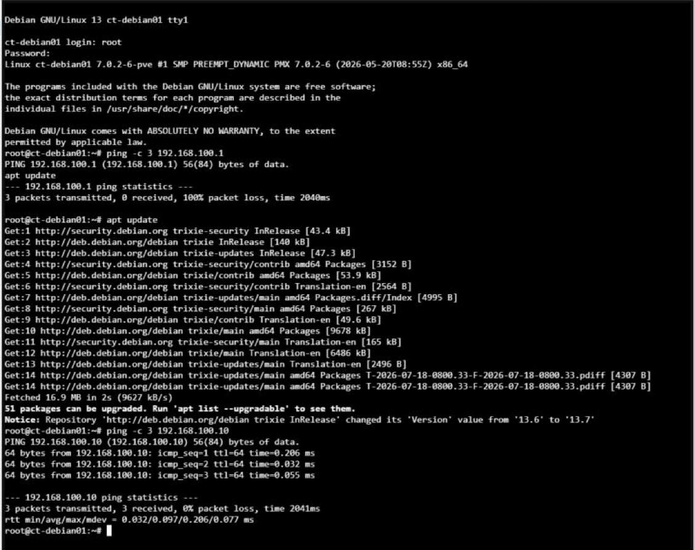

# 04 – Netzwerk

**Status:** 🔄 in Arbeit – isoliertes Netz mit NAT ✅

## Ziel

Proxmox ein eigenes Netzwerk geben, das die Lab-Umgebung nicht stört, aber trotzdem Internetzugang hat.

## Durchgeführte Schritte

Auf dem Windows Server 2019 (PowerShell als Administrator):

```powershell
New-VMSwitch -Name "Proxmox-Intern" -SwitchType Internal
New-NetIPAddress -IPAddress 192.168.100.1 -PrefixLength 24 -InterfaceAlias "vEthernet (Proxmox-Intern)"
New-NetNat -Name "Proxmox-NAT" -InternalIPInterfaceAddressPrefix 192.168.100.0/24
```

| Gerät | IP-Adresse |
|-------|-----------|
| Windows Server (Gateway, NAT) | 192.168.100.1 |
| Proxmox PVE01 | 192.168.100.10 |
| Container ct-debian01 | 192.168.100.20 |

Warum ein eigenes Netz? Im Lab-Netz vergibt ein DHCP-Server die Adressen. Eine feste IP für Proxmox könnte dort mit anderen Geräten kollidieren. Das interne Netz mit NAT ist davon komplett getrennt.

## Probleme & Lösungen

**Problem: Ping zum Gateway schlägt fehl**
`ping -c 3 192.168.100.1` → 100 % packet loss
Aber: `apt update` im Container funktioniert – der Internetzugang über das Gateway läuft also.
Ursache: Die **Windows-Firewall** blockiert eingehende ICMP-Echo-Anfragen (Ping) standardmäßig.
Test zur Bestätigung: `ping -c 3 192.168.100.10` (Proxmox, Linux) → 0 % packet loss.

## Screenshots



## Was ich gelernt habe

- Interner Hyper-V-Switch + NAT = isoliertes Netz mit Internetzugang.
- Ein fehlgeschlagener Ping bedeutet nicht automatisch, dass keine Verbindung besteht – die Firewall kann ICMP blockieren.
- Mehrere Tests kombinieren (Ping, DNS, Download), um ein Netzwerkproblem einzugrenzen.
