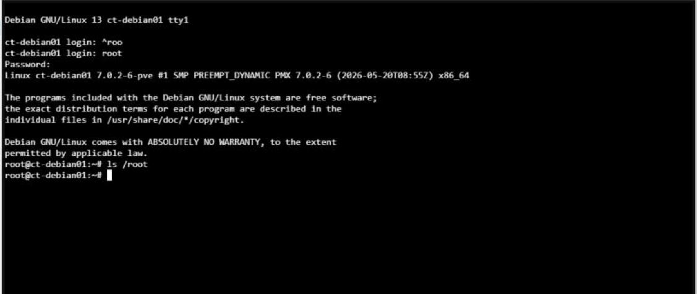

# 05 – Snapshots & Backup

**Status:** 🔄 in Arbeit – Snapshot ✅, Backup mit `vzdump` geplant

## Ziel

Einen Systemzustand sichern und nach einer Änderung wiederherstellen.

## Durchgeführte Schritte

1. Container CT 100 → Snapshots → **Take Snapshot**, Name: `vor_test`
2. Änderung im Container:
   ```bash
   echo "Testdatei" > /root/test.txt
   ls /root        # test.txt ist da
   ```
3. Snapshot `vor_test` → **Rollback** → Container neu gestartet
4. Kontrolle:
   ```bash
   ls /root        # leer – test.txt ist weg
   ```

Ergebnis: Der Container ist wieder genau im Zustand vor der Änderung.

## Probleme & Lösungen

Keine.

## Screenshots



## Was ich gelernt habe

- Ein **Snapshot** speichert den Zustand zu einem Zeitpunkt – gut vor Updates oder Tests.
- Ein Snapshot ist **kein Backup**: Er liegt auf demselben Speicher. Fällt der Speicher aus, ist auch der Snapshot weg. Dafür braucht man ein Backup (`vzdump`) auf einem anderen Speicher.
