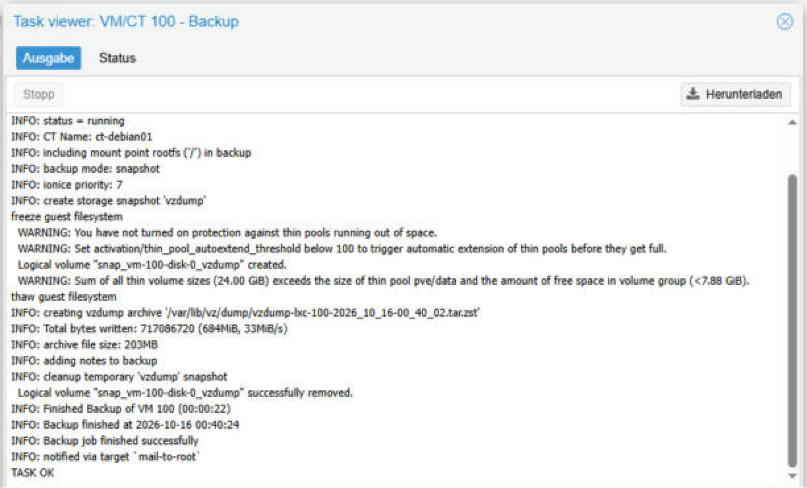
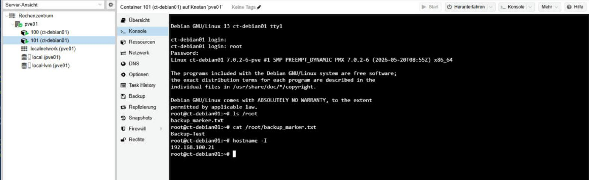
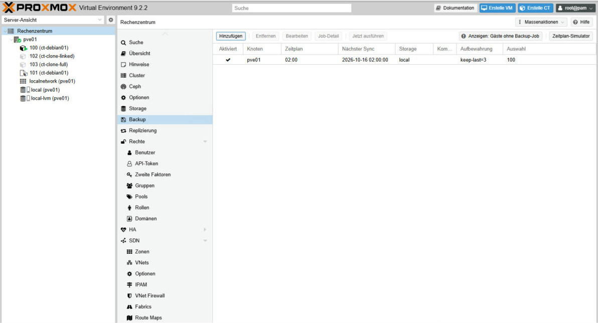

# 05 – Snapshot, Backup, Restore & Backup-Job

**Status:** ✅ erledigt (14.–16.10.2026)

> 🇬🇧 **In short:** Tested a snapshot rollback, created a `vzdump` backup of CT 100 and restored it as CT 101 (a marker file proved the data was there). Finally set up a nightly backup job at 02:00 that keeps the last 3 backups.

## Was und warum

- **Snapshot:** Zustand schnell sichern, z. B. vor einem Update.
- **Backup:** Kopie auf einem anderen Speicher – schützt auch, wenn die Disk ausfällt.
- **Restore-Test:** Ein Backup ist nur gut, wenn man es zurückspielen kann.
- **Backup-Job:** Backups automatisch, ohne daran denken zu müssen.

## Teil 1 – Snapshot und Rollback

1. Snapshot `vor_test` von CT 100 erstellt.
2. Testdatei angelegt: `echo "Testdatei" > /root/test.txt`
3. Rollback auf `vor_test` → `ls /root` ist leer. Der alte Zustand ist zurück.

## Teil 2 – Backup mit vzdump

1. Marker-Datei in CT 100: `echo "Backup-Test" > /root/backup_marker.txt`
2. CT 100 → Backup → **Backup now**: Storage `local`, Mode `Snapshot`, Compression `ZSTD`.
3. Ergebnis: `TASK OK` nach 22 Sekunden, Datei mit 204 MB.

## Teil 3 – Restore als neuer Container

1. Backup → **Restore** als **CT 101**, Storage `local-lvm`, Option **Unique** (neue MAC-Adresse).
2. IP von CT 101 auf `192.168.100.21` geändert – sonst IP-Konflikt mit CT 100.
3. Kontrolle in CT 101:

```text
root@ct-debian01:~# cat /root/backup_marker.txt
Backup-Test
root@ct-debian01:~# hostname -I
192.168.100.21
```

Die Marker-Datei ist da – das Backup enthält die echten Daten. CT 101 wurde später zum Template (siehe [03](03-templates-klonen.md)).

## Teil 4 – Nächtlicher Backup-Job

Datacenter → Backup → **Add**:

| Einstellung | Wert |
|-------------|------|
| Node / Storage | pve01 / local |
| Schedule | täglich 02:00 |
| Auswahl | nur CT 100 |
| Mode / Compression | Snapshot / ZSTD |
| Retention | Keep Last: 3 |

Test mit **Jetzt ausführen**: `TASK OK` in 22 Sekunden.

```text
/var/lib/vz/dump/
vzdump-lxc-100-2026_10_16-00_40_02.tar.zst   204M
vzdump-lxc-100-2026_10_16-01_32_27.tar.zst   204M
```

**Warum Keep Last 3?** Ohne Grenze füllen die täglichen Backups die Disk. Mit Keep Last 3 löscht Proxmox ältere Backups automatisch.

## Troubleshooting

| Meldung | Bedeutung | Maßnahme |
|---------|-----------|----------|
| `Sum of all thin volume sizes ... exceeds the size of thin pool` | **Thin Provisioning:** Den Disks ist mehr Platz zugesagt, als der Pool hat. Belegt wird nur, was geschrieben wird. | Warnung, kein Fehler. Belegung mit `lvs` beobachten. |
| `Konsole: Fehler` in der Task-Liste | Konsole wurde beim Herunterfahren des Containers getrennt | Harmlos |

## Screenshots






## Was ich gelernt habe

- **Snapshot ≠ Backup.** Ein Snapshot liegt auf demselben Speicher, ein Backup nicht.
- Ein Backup immer mit einem **Restore-Test** prüfen.
- Automatische Backups brauchen eine **Aufbewahrungsregel** (Retention), sonst läuft der Speicher voll.
- Hinweis: Echte Backups gehören auf ein **anderes Gerät** (z. B. Proxmox Backup Server oder NAS). Im Lab liegt das Backup auf demselben Host.
